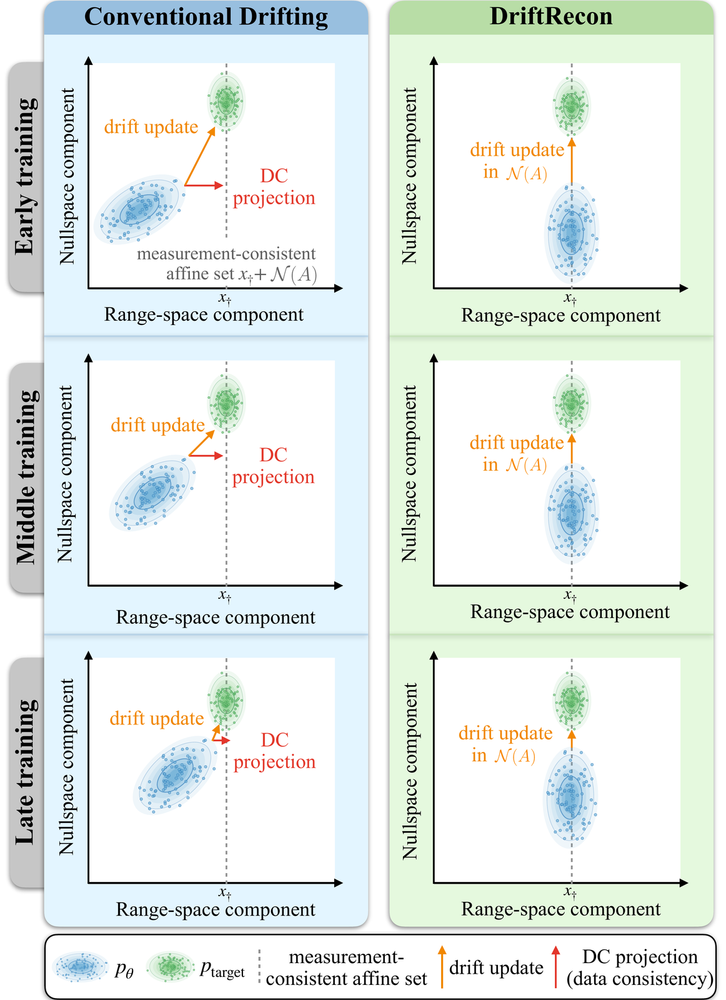

# Guidance-Coupled Nullspace Drifting for One-Step Medical Image Reconstruction

M. Tuna Alatan, A. Server Tapan, Saban Ozturk, M. Usama Mirza, Bilal Kabas, Ge Wang, and Tolga Çukur

[[arXiv]](https://arxiv.org/abs/2610.38953)

Official implementation of **DriftRecon** for sparse-view CT and accelerated multi-coil
MRI. DriftRecon is a generative method for one-step medical image reconstruction. It performs
drifting in the nullspace of the imaging operator, and its conditional guidance parameter uses a
coupled kernel temperature to steer the fidelity–realism trade-off at inference.

<p align="center">
  
</p>

*The input is the anchor `x† = A†y` plus nullspace-restricted noise `(I − A†A)ε`. The multi-scale generator
`g_θ` is conditioned at every stage on `(x†, y, A, α, c)`. Its output `h` is projected onto the nullspace
of `A`, `ẑ = P_N h`, and the final reconstruction is `x̂ = x† + ẑ`. Training applies the image loss
`L_img` to `h` and the nullspace drift and nullspace losses `L_drift^N + L_null` to `ẑ`.*

## Method

<table>
  <tr>
    <td align="center" width="50%"></td>
    <td align="center" width="50%"></td>
  </tr>
  <tr>
    <td><em><b>Nullspace drifting.</b> Conventional drifting moves samples in the full image space and
    relies on a separate data-consistency projection. DriftRecon drifts only the nullspace component
    around the measurement-consistent set <code>x† + N(A)</code>.</em></td>
    <td><em><b>Guidance-coupled temperature.</b> With a fixed kernel temperature, stronger guidance
    (α &gt; 1) lets far-away negatives skew the drift direction. The coupled schedule
    <code>τ(α) = τ₀ / (1 + β(α − 1))</code> localizes interactions as guidance grows.</em></td>
  </tr>
</table>

Vector versions of the figures are in `docs/figures/*.pdf`.

## Layout

```
src/driftrecon/
  core/   drift.py (CFG drift, Haar bands, objective)   cg.py (H1-CG A_dagger / soft null projector)
          conditioning.py (CFG + domain/contrast condition, FiLM)   ema.py   cli.py
  ct/     physics.py (matched parallel-beam operator)   model.py (DriftReconCT)   data.py
          trainer.py   train.py   test.py   reconstruct.py
  mri/    physics.py (SENSE operator, multi-scale/padded wrappers)   model.py (DriftReconMRI)
          data/m4raw.py (cache, ESPIRiT, masks, dataset)   trainer.py   train.py   evaluate.py   build_cache.py
data_prep/ct/   LoDoPaB-CT image_fs.npz -> one [0,1] 352x352 .npy per slice
scripts/ct/     prepare_lodopab.sh -> train.sh -> select_checkpoint.sh -> test.sh
scripts/mri/    build_cache.sh     -> train.sh -> select_checkpoint.sh -> test.sh
tools/          ct_metrics.py  mri_metrics.py (paper metrics)   avg_ckpt.py (checkpoint weight averaging)
                convert_legacy_checkpoint.py
tests/          core / ct / mri / tools unit tests
docs/figures/   paper figures (PNG for this page, PDF vector originals)
```

## Install

```bash
python -m venv .venv && source .venv/bin/activate
pip install -e '.[all]'            # or .[mri], .[images], .[eval] as needed
# optional GPU ESPIRiT: pip install cupy-cuda12x
pytest                             # CPU unit tests
```
Tested with Python 3.12 and PyTorch 2.x on a single NVIDIA RTX 5090 (32 GB).

## Sparse-view CT (LoDoPaB-CT)

Data: LoDoPaB-CT (Zenodo [10.5281/zenodo.3384092](https://doi.org/10.5281/zenodo.3384092)). Only the
reference images are used: `$LODOPAB_ROOT/{train,val,test}/image_fs.npz` (352 x 352, attenuation normalized
to [0, 1]). Sinograms are simulated with a parallel-beam operator with 498 detectors and angles uniformly
spaced over [0, π]; R = 4 / 6 / 8 / 10 corresponds to 88 / 58 / 44 / 35 views.

```bash
LODOPAB_ROOT=/path/to/lodopab-ct bash scripts/ct/prepare_lodopab.sh   # data/lodopab/{train,val,test}/*.npy
R=6 bash scripts/ct/train.sh                                          # checkpoints/lodopab_R6/model_001000.pth ...
R=6 bash scripts/ct/select_checkpoint.sh                              # outputs/val_lodopab_R6/summary.csv
python tools/avg_ckpt.py --dir checkpoints/lodopab_R6 --steps A:B:1000 --out checkpoints/lodopab_R6/model_avg.pth
R=6 CKPT=checkpoints/lodopab_R6/model_avg.pth bash scripts/ct/test.sh
```

## Accelerated multi-coil MRI (M4Raw)

Data: M4Raw v1.6 (Zenodo [10.5281/zenodo.8056074](https://doi.org/10.5281/zenodo.8056074)). Extract the
archives so that `$M4RAW_ROOT/multicoil_{train,val,test}/*.h5` exist.

```bash
export M4RAW_ROOT=/path/to/M4Raw CACHE_DIR=/fast/disk/m4raw_cache
bash scripts/mri/build_cache.sh                                 # optional; otherwise built on first use
bash scripts/mri/train.sh                                       # checkpoints/m4raw/model_001000.pth ...
bash scripts/mri/select_checkpoint.sh                           # outputs/mri_val/summary.csv, best.json
python tools/avg_ckpt.py --dir checkpoints/m4raw --steps A:B:1000 --out checkpoints/m4raw/model_avg.pth
CKPT=checkpoints/m4raw/model_avg.pth bash scripts/mri/test.sh
```

## Citation

```bibtex
@article{alatan2026driftrecon,
  title   = {Guidance-Coupled Nullspace Drifting for One-Step Medical Image Reconstruction},
  author  = {Alatan, M. Tuna and Tapan, A. Server and Ozturk, Saban and Mirza, M. Usama and Kabas, Bilal and
             Wang, Ge and {\c{C}}ukur, Tolga},
  journal = {arXiv preprint arXiv:2610.38953},
  year    = {2026},
  eprint  = {2610.38953},
  archivePrefix = {arXiv},
  url     = {https://arxiv.org/abs/2610.38953}
}
```

## License

BSD 3-Clause (`LICENSE`). See `THIRD_PARTY_NOTICES.md`.
